<h1>Cliente e Servidor:</h1> O http é um protocolo utilizado para permitir a comunicação entre um cliente e um servidor. O cliente pode ser um navegador, como o Google, enquanto o servidor é o sistema que recebe as requisições e envia as respostas. Pode ser resumido por etapas como ocorre desde digitar uma URL no navegador até a página aparecer.

DNS é o mecanismo que traduz nomes de domínio como por exemplo (senac.com.br) para endereços de IP(574.0.4.123), em seguida o navegador precisa estabelecer uma comunicação com o servidor, o PC do usuário abre uma conexão com o servidor e usa um processo chamado Three-Way-Handshake.
TCP: Estabelece uma conexão confiável entre o navegador e o servidor
TLS: em sites HTTPS estabelece a segurança da comunicação,criptografando os dados e verificando a identidade do servidor

Com a conexão pronta o navegador envia uma requisição HTTP ao servidor,solicitando o recurso desejado.
Uma requisição pode conter:
- Método:Indica a ação,como GET para buscar uma página.
- URL ou caminho: indica o recurso solicitado
- Cabeçãlhos: Trazem informações sobre o navegador, formato aceitos e outros dados

O servidor envia de volta:

HTML
CSS
JavaScript
Imagens
Exemplo:

HTTP/1.1 200 OK
Content-Type: text/html

Quando recebe o HTML, o navegador começa a interpretar o conteúdo e a montar a página
O HTML define a estrutura e os elementos.
O CSS define cores, fontes, tamanhos e posicionamento.
O JavaScript pode adicionar interatividade e modificar o conteúdo.
O navegador calcula o layout e desenha os elementos na tela.

<h1>Anatomia da requisição e da resposta:</h1>
 Linha inicial: informa o método, o caminho e a versão do protocolo na requisição; na resposta, informa a versão do protocolo, o código de status e a mensagem correspondente.
Cabeçalhos (headers): fornecem informações sobre a mensagem, como o tipo de conteúdo e o tamanho do corpo.
Corpo (body): contém os dados enviados, como um formulário, um JSON ou um documento HTML. Ele é opcional e nem toda mensagem possui corpo

Exemplo de requisição:

GET /sobre HTTP/1.1
Host: localhost:3000
User-Agent: Mozilla/5.0
Accept: text/html

Exemplo de resposta HTTP:

HTTP/1.1 200 OK
Content-Type: text/html; charset=utf-8
Content-Length: 45
Servidor funcionando em localhost3000.

<h1>Métodos HTTP: GET,PUT,POST e DELETE:</h1>
Os métodos HTTP são usados para definir ações específicas em recursos de um servidor e são amplamente utilizados em APIs RESTful para realizar operações CRUD (Create, Read, Update, Delete).

GET

O método GET é usado para solicitar dados de um recurso específico no servidor. Ele não altera o estado do recurso e é considerado seguro e idempotente. Por exemplo, ao acessar uma URL, o navegador realiza uma requisição GET para obter o conteúdo da página.

PUT

O método PUT é usado para criar ou atualizar um recurso no servidor. Ele é idempotente, ou seja, múltiplas requisições PUT com os mesmos dados produzirão o mesmo resultado.

POST

O método POST é utilizado para criar novos recursos ou enviar dados ao servidor. Diferentemente do PUT, ele não é idempotente, pois múltiplas requisições podem criar recursos duplicados

DELETE

O método DELETE é usado para remover um recurso específico no servidor. Ele também é idempotente, pois múltiplas requisições para deletar o mesmo recurso terão o mesmo efeito.

<h1>Códigos de status:</h1>

1xx- Informativos:	A requisição foi recebida e o processamento continua.

2xx-Sucesso:	A requisição foi recebida, compreendida e processada com sucesso.

3xx-Redirecionamento: é necessário realizar outra ação para concluir a requisição, geralmente acessar outra URL ou utilizar um recurso em cache.

4xx - Erro do cliente: A requisição apresenta algum problema ou não pode ser atendida nas condições solicitadas.

5xx -	Erro do servidor: O servidor falhou ao processar uma requisição aparentemente válida.

<h1>Significado dos principais códigos:</h1>

200- Sucesso:A requisição foi processada com sucesso. Por exemplo, uma página foi carregada normalmente.

201 Created	- Criado: Uma requisição foi concluída e um novo recurso foi criado, como um usuário cadastrado por uma API.

301 Moved Permanently -	Movido permanentemente:	O recurso foi transferido definitivamente para outra URL.

302 Found- Encontrado:	O recurso está temporariamente disponível em outra URL, para a qual o cliente normalmente é redirecionado.

304 Not Modified -Não modificado:Indica que o recurso não mudou desde a última versão armazenada em cache, permitindo reutilizá-la.

400 Bad Request - Requisição inválida:O servidor não consegue processar a requisição devido a um erro, como dados malformados.

401 Unauthorized -Não autenticado:A requisição exige autenticação válida, mas as credenciais estão ausentes ou são inválidas.

403 Forbidden -	Proibido:O servidor entendeu a requisição, mas se recusa a autorizá-la.

404 Not Found - Não encontrado:O recurso solicitado não foi encontrado no servidor.

405 Method Not Allowed - Método não permitido:O método HTTP utilizado não é permitido para aquela rota. Por exemplo, enviar POST a uma rota que aceita apenas GET.

500 Internal Server Error -	Erro interno do servidor:O servidor encontrou uma condição inesperada que impediu o processamento da requisição.

<h1>Diferença entre 401 e 403</h1>
- 401 Unauthorized: o usuário precisa se autenticar ou apresentar credenciais válidas. Por exemplo, tentar acessar uma API protegida sem enviar um token de autenticação.
- 403 Forbidden: o servidor não permite o acesso ao recurso. Por exemplo, um usuário autenticado tenta acessar uma área exclusiva para administradores.

<h1>Diferença entre 301 e 302</h1>
- 301 Moved Permanently: indica que o endereço do recurso mudou permanentemente. O navegador pode atualizar seus registros e utilizar a nova URL em acessos futuros.
- 302 Found: indica um redirecionamento temporário. O endereço original continua sendo considerado o endereço do recurso.

<h1>Cabeçalhos</h1>

Content-Type	Informa o tipo de conteúdo enviado no corpo da mensagem.	Content-Type: application/json
Content-Length	Informa o tamanho do corpo da mensagem em bytes.	Content-Length: 120
Location	Indica a URL de destino de um redirecionamento ou o endereço de um recurso recém-criado.	Location: /usuarios/10
Allow	Informa quais métodos HTTP são permitidos para um recurso. É especialmente utilizado em respostas 405 Method Not Allowed.	Allow: GET, POST
Cache-Control	Define regras para armazenamento em cache e reutilização das respostas.	Cache-Control: no-cache
User-Agent	Identifica informações sobre o cliente que está realizando a requisição, como navegador e sistema operacional.	User-Agent: Mozilla/5.0
Accept	Informa quais tipos de conteúdo o cliente aceita receber na resposta.	Accept: text/html, application/json

<h1>HTTP é stateless:</h1>

O protocolo HTTP é considerado stateless, ou seja, sem estado. Isso significa que o servidor não guarda automaticamente informações sobre as requisições anteriores de um cliente. Cada requisição é tratada como uma comunicação independente, e o servidor não precisa se lembrar do que aconteceu nas requisições anteriores para processar a próxima.

Essa característica simplifica o protocolo, pois permite que as requisições sejam processadas sem depender necessariamente de um histórico de comunicações anteriores. Isso facilita a escalabilidade e permite que servidores distribuam requisições entre diferentes máquinas.

<h1>HTTP x HTTPS: </h1>
O HTTP é um protocolo utilizado para a comunicação entre o navegador e o servidor. Já o HTTPS é a versão segura do HTTP, que utiliza criptografia por meio do TLS para proteger os dados transmitidos.

<h1>Evidencias</h1>

#### 1. Rota `/` (Página Home)

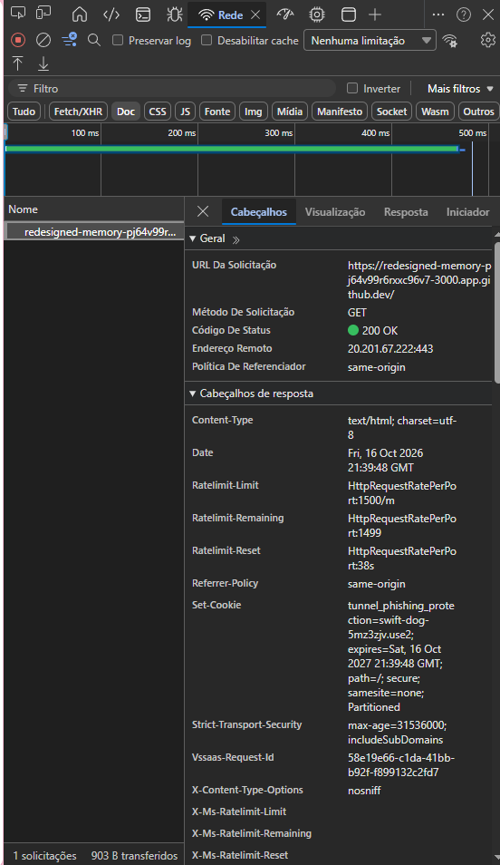

#### 2. Rota `/sobre` (Página Sobre)

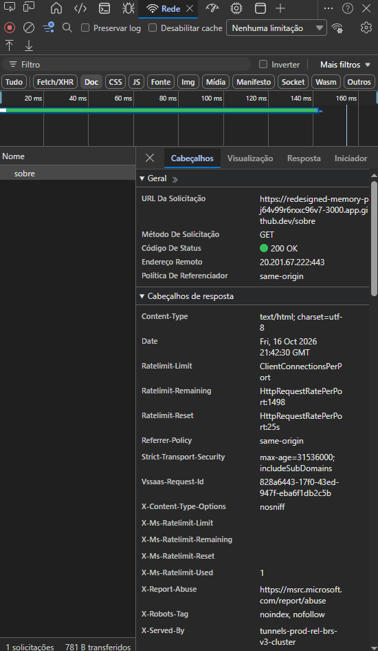

#### 3. Rota `/antigo` (Página Antigo)
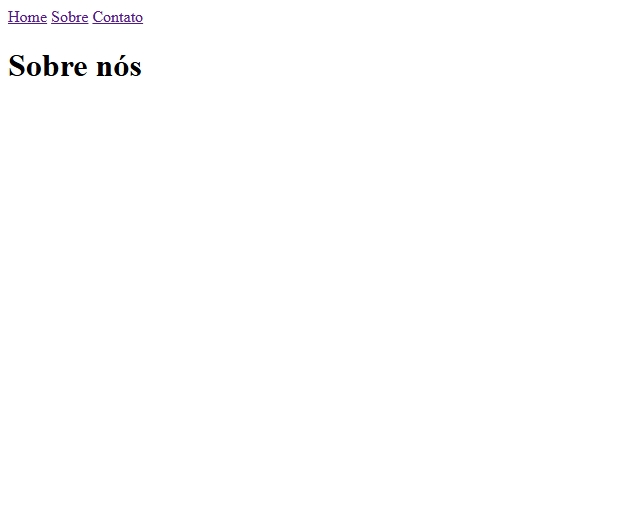
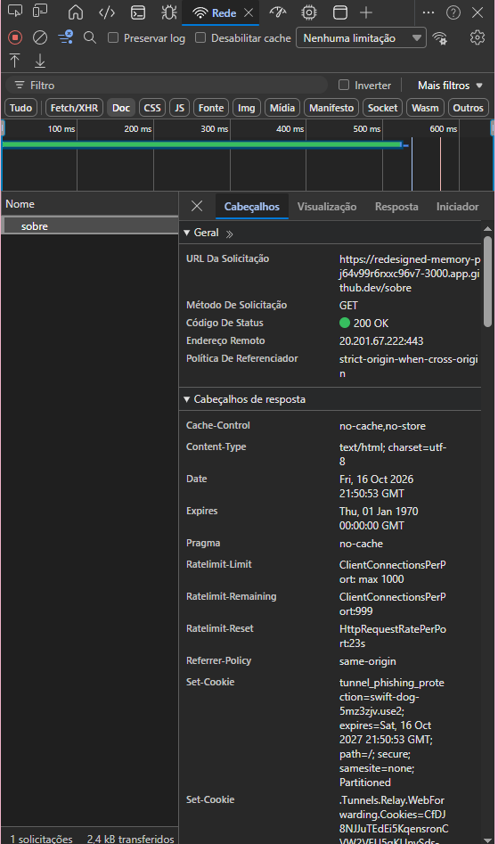

#### 4. Rota `/busca` (Página busca)

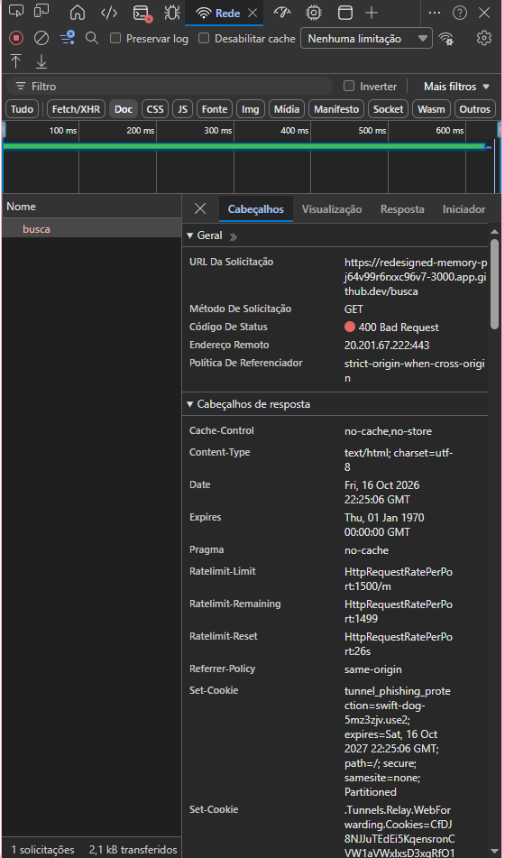

#### 5. Rota `/buscatermo` (Página BuscaTermo)

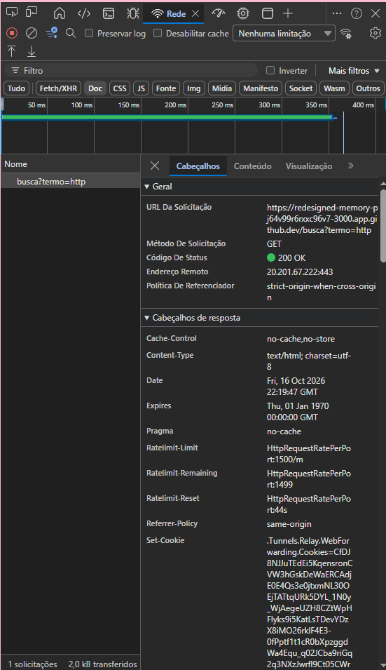

#### 6. Rota `/admin` (Página Admin)
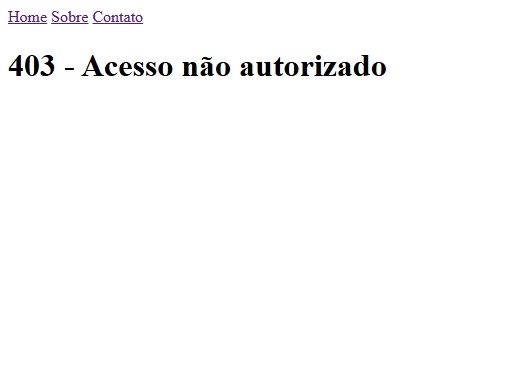
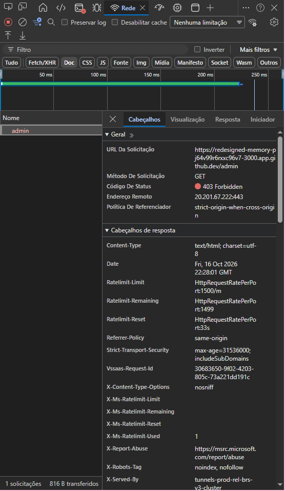

#### 7. Rota `/contato` (Página Contato)

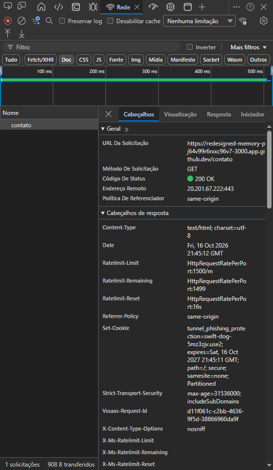

#### 8. Rota `/notfound` (Página NotFound)
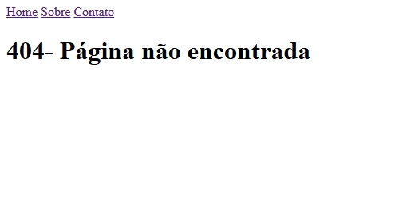
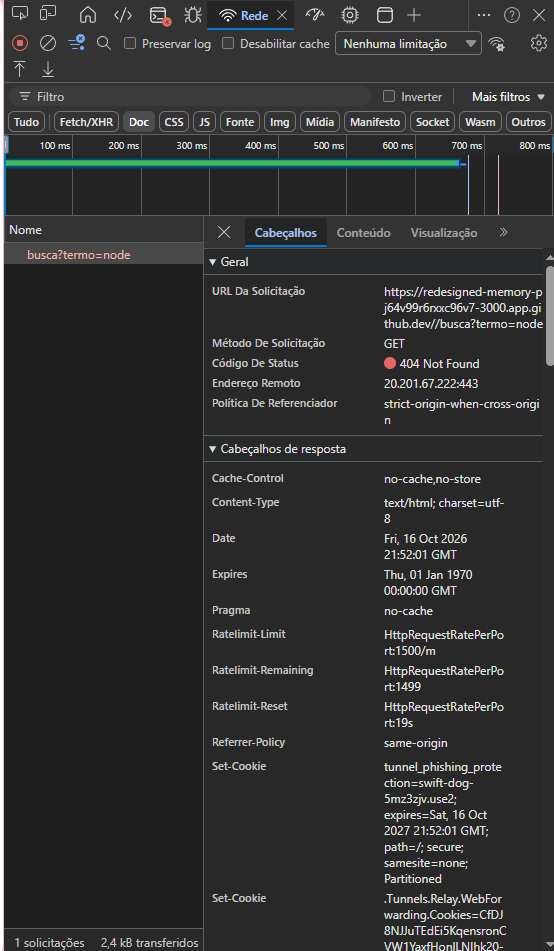

#### 9. Rota `/rota invalida` (Página Inválida)
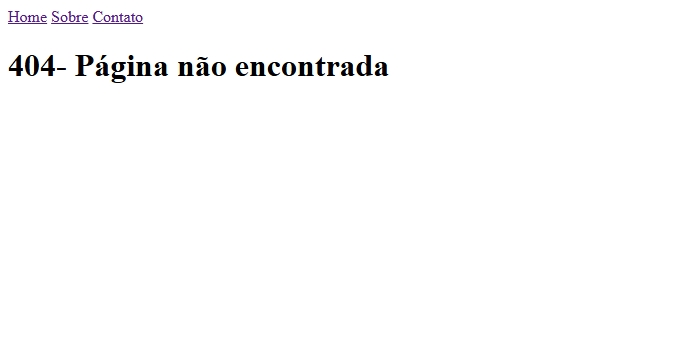
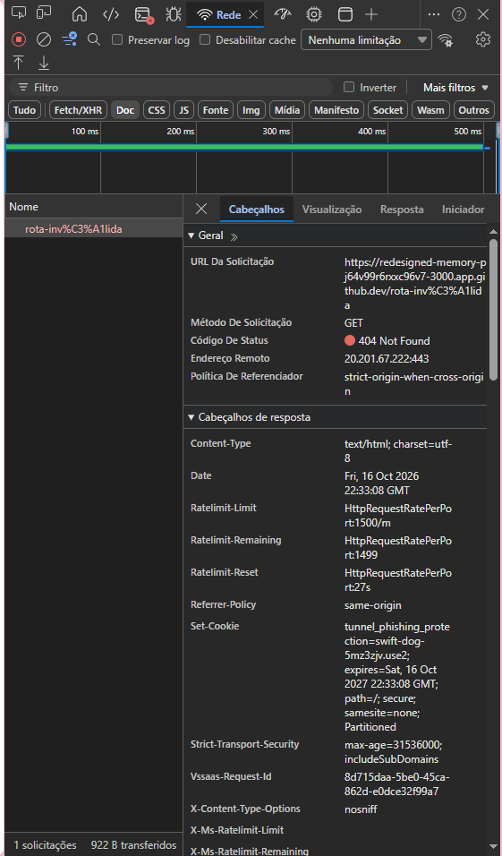

<h1>Conclusão</h1>
Nessa conclusão eu diria que mudaria no meu projeto a forma de organização, quando comecei a fazer da maneira organizada consegui entender com precisão o que estava sendo proposto, revisaria o status de código para ver se está tudo ocorrendo bem, além disso, melhoraria as mensagens de erro para ajudar o usuário a entender o que aconteceu. 

<h1>Referências</h1>
https://blog.devdata.com.br/do-enter-ao-dns-o-que-realmente-acontece-quando-voce-vai-acessar-um-site-direto-do-seu-navegador-artigo/
https://tads-ufpr-alexkutzke.github.io/ds122-alexkutzke/aula_03_http.html
https://wiry-gray-611.notion.site/Aula-04-Roteamento-Manual-por-URL-e-M-todo-ab288e2f5f8e82cb9092017b5ae2fdf9

<h1>Declaração do uso de IA</h1>
OPENAI. ChatGPT (modelo utilizado). Ferramenta de inteligência artificial generativa.
Data de uso: 16 outubro. 2026.
Finalidade: Auxiliar em erros que aconteceram durante o processo do trabalho

